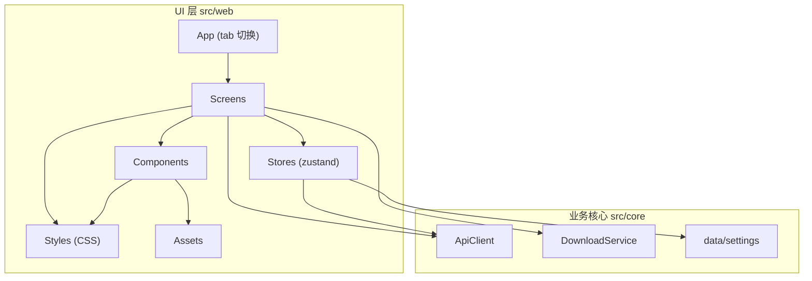
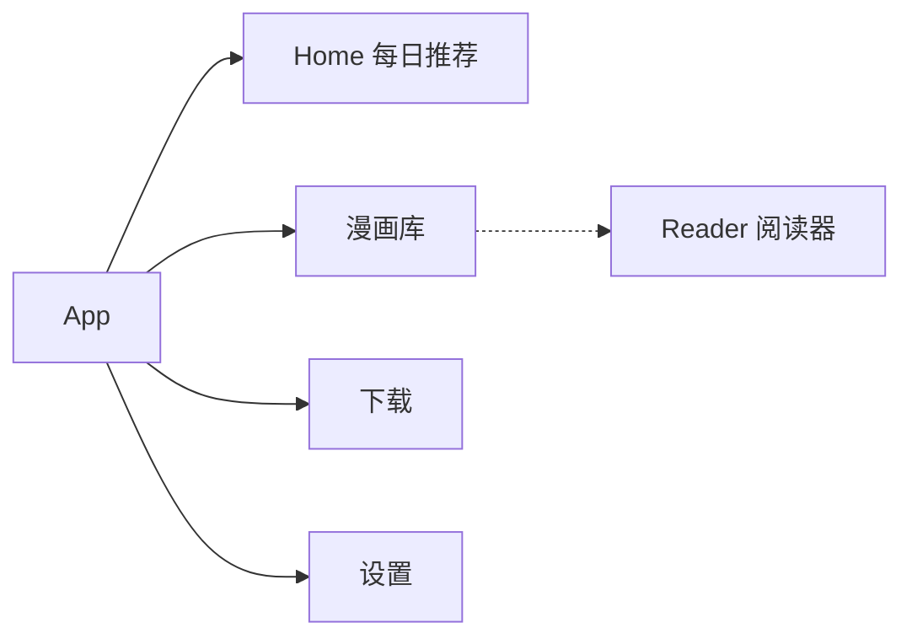
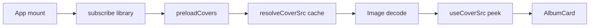
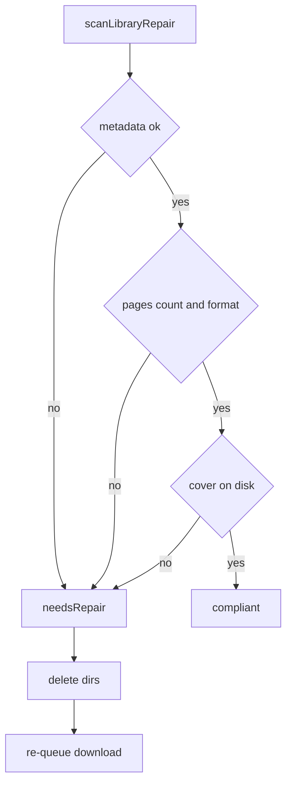

# UI 架构

JMFM 的 UI 层位于 `src/web`（React DOM + CSS），运行在 Capacitor 壳的 WebView 内，与业务核心 `src/core` 完全分离。UI 层仅通过 `ApiClient`、`DownloadService`、`Settings` 三个入口消费业务能力，不直接触碰网络、加解密与文件逻辑。

## 分层框架



- **App**：轻量 state tab 切换，承载 4 个主页面（无路由库）。
- **Screens**：`src/web/features/<feature>/index.tsx` 页面级组件，只负责组合与事件分发，无业务实现。
- **Stores**：zustand 状态库，页面通过 store 读写 UI 状态，并桥接 `core` 的服务。
- **Components**：基础件在 `src/web/ui/`（每目录 `index.tsx` + 同名 `.module.css`）；≥2 个 feature 共用才提升到 `src/web/shared/`。
- **Styles**：组件用 `*.module.css` 与组件共置；全局 CSS 只剩 `styles/fonts.css` 与 `styles/shell.css`（25 个契约类 + tabbar）。
- **Assets**：图标（Iconify SVG）与字体（Alimama / BebasNeue）统一存放。
- **i18n**：全部用户可见文案走 `t(key)`，字典在 `src/web/i18n/zh-CN.ts`。

## 导航结构



### 页面表

| 名称 | 组件 | 说明 |
| --- | --- | --- |
| `Home` | `HomeScreen` | 每日推荐列表 |
| `Library` | `LibraryScreen` | 本地漫画库 + 搜索 + 分类筛选（全部/收藏/已下载/常看） |
| `Tasks` | `TasksScreen` | 下载任务与进度（串行排队） |
| `Settings` | `SettingsScreen` | 应用设置 |
| `Reader` | `ReaderScreen` | 阅读器：图片直读 |

## 页面职责

- **Home**：分区自上而下为 顶栏（品牌 + 搜索）→ Hero（本周焦点）→ 继续阅读 → 今日推荐网格 → 人气榜 Top8 → 最近更新（相对时间）→ 分类 chips。全部数据派生自现有 store，无新增接口：Hero 取推荐池 `likesCount` 最高者；人气榜用 `useBrowseStore.hot`；最近更新由 `useDailyStore.albums` 按 `updateAt` 倒序。推荐本身仍走 `buildRecommendations`（白名单 → 偏爱标签 → 时间梯度补齐 6 本），按日缓存，支持 dismiss / 刷新。
- **Library**：展示已下载漫画，支持搜索与四分类筛选（全部/收藏/已下载/常看），支持收藏、删除、打开阅读；删除使用 `ConfirmDialog`。搜索框为 `shared/SearchBar`（capsule），与下载页 ID 输入框同构，顶部间距 `--space-3`。
- **Tasks**：展示下载队列与实时进度，支持暂停/继续/删除；多本经 `queue.ts` 串行；完成 3s 后 Web Animations 高度折叠离场；卡片为标题左对齐 + 状态徽章（无对号图标）。顶部 ID 输入框为 `ui/Input` capsule 变体，与资源页搜索框共享同一度量。
- **Reader**：图片直读（`image-reader.tsx` + `image-loader.ts`）：纵向窗口 ±1/+3，横向三页轨道。`ReaderScreen` 由 `App` 用 `React.lazy` 懒加载。
- **Settings**：主题、阅读方式、下载路径（支持 SAF 目录授权）、启用代理；分组为显示 / 下载 / 网络 / 内容过滤 / 通用，全部用 `ui/ListGroup` 卡片承载；「通用 → 修复文件」扫描并补齐缺失页面与封面，扫描进度条与入队提示常驻（跨 Tab 不中断）；「检查更新」下载进度由 `useUpdateStore` 承载，切页后回设置页仍可见。

## 封面预加载



- `src/web/library/coverCache.ts`：URI 缓存 + inflight 去重 + `preloadCovers`。
- App 启动与库变更时预热前 8 张封面（其余懒加载）；入库后立即预热单本封面，切 Tab 不再因封面加载跳变。

## 资源修复



## 状态管理

| Store | 职责 |
| --- | --- |
| `useSettingsStore` | 包装 `data/settings` 的读取与持久化（Capacitor Preferences / localStorage） |
| `useDownloadStore` | 下载任务集合与进度（pending / running / paused / done / error） |
| `useLibraryStore` | 本地已下载漫画（`LibraryItem`，含 `pagesDir` / `coverPath`），支持收藏 / 常看 / 删除 |
| `useDailyStore` | 今日推荐池、dismiss、刷新；拉取逻辑下沉到 `library/dailyFetch.ts` |
| `useBrowseStore` | 分类树 + 本周热门（`hot` / `loadHot`），Home 与 Discover 共用 |
| `useBrowseFeedStore` | 发现页分页缓存，键 `category\|order`，用 `library/pagedFeed.ts` 合并页 |
| `useSearchStore` | 搜索结果分页，同样复用 `pagedFeed` 的 slice 形状 |

### 拼页与骨架

- 分页合并（append / dedupe / end / LRU 缓存）统一在 `src/web/library/pagedFeed.ts`，`browseFeed` 与 `search` 只保留 API 差异。
- **stale-while-revalidate**：切分类/排序时若新键无缓存，`selectVisibleFeed` 继续渲染上一份列表，顶栏显示细进度条（`.nav-scroll.is-switching`），不再闪 `EmptyState`。
- **无限滚动门控**：`useInfiniteScroll` 对一次「可见」只触发一次加载，请求结束（`disabled` 回 false）后再解锁，避免 loading 中重复翻页。
- **骨架屏**：`src/web/shared/Skeletons.tsx` + `skeletons.module.css` 提供 6 卡网格、列表行、热门横滑、分类格子四种占位；加载中取代 `app-empty`，`app-empty--fixed` 保留 240px 高度，页面不再塌陷。

## 交互约束

- `ListTile` 在 `isInput` / `isToggle` / 自定义 `trailing`（ReactNode）时根节点渲染为 `<div role="group">`，仅整行可点时才是 `<button>`，避免 `<button>` 嵌套 `<button>`。
- 列表订阅 store 时，选择器返回数组/对象必须加 `useShallow` 或改为布尔判断，否则 React 19 会因 `getSnapshot` 不稳定触发无限渲染。
- **Tab keep-alive**：`useTabKeepAlive` 让 tab 首次访问后常驻挂载，未激活容器 `hidden`，切换时恢复 `.app-screen` 的 `scrollTop`。Library 仍首次访问才挂载，避免启动即扫盘。
- **左缘返回**：`useEdgeSwipeBack` 只在导航层存在时生效，起手 28px 内、水平位移 >64px 才 `back()`；拖拽直接写在 `.nav-layer` 的 transform 上，松手复位或交给 `is-closing` 动画。
- **折叠头部**：`useHideOnScroll` 在捕获阶段监听 `.app-screen` 滚动，下滑 24px 隐藏 tabbar 与首页顶栏（`.chrome-hidden`），上滑或回到顶部即恢复。
- **下拉刷新**：`usePullToRefresh` 仅指针为 coarse 时启用，`.app-screen` 处于顶部且下拉 80px 触发；Home 刷新推荐 + 热门。位移只加在 `.app-screen` 的非 `.sticky-chrome` 子节点上（`--pull-y`），搜索栏因此保持 sticky 钉在顶部；`touchmove` 用 `requestAnimationFrame` 合帧且仅在下拉进行中非 passive 拦截原生 overscroll。

## 样式体系

`src/web/theme/index.css` 分两层：**primitive**（`--c-ink-*`、`--c-coral-*`、`--c-jade/amber/rose`、`--c-tint-*`）与 **semantic**（`--surface-*`、`--ink-*`、`--accent-*`、`--cover-*`、`--color-edge`、`--hairline`、`--scrim(-weak)`、`--radius-*`、`--shadow-1/2/3`、`--dur-*`、`--ease-*`）。

- **暗色优先**：`:root` 即暗色语义；`[data-theme='light']` 只重绑 primitive/alias，组件选择器不换。`src/data/settings.ts` 默认 `theme: 'dark'`。
- 组件 CSS 只引用 semantic token，禁止裸 hex / `rgba()`；封面底色统一走 `--cover-tint-1..6`，渐变走 `--cover-scrim` / `--cover-scrim-full`。
- 组件样式写在组件旁的 `*.module.css`，由 `scripts/check-tokens.ts` 强制：裸颜色、非 token 的 padding/margin/gap、`calc(var(--z-*) ± N)` 一律报错，`/* token-ignore: 理由 */` 可白名单。
- 全局 CSS 只剩 `styles/fonts.css`（`@font-face`）与 `styles/shell.css`；后者只允许 JS 触达的契约类：`.app`、`.app-content`、`.app-screen`、`.app-tabbar`、`.app-empty(-fixed)`、`.sticky-chrome`、`.tab-pane(-inner)`、`.tab-item`、`.tab-icon`、`.tab-label`、`.nav-layer`、`.nav-screen`、`.nav-scroll`、`.chrome-hidden`、`.is-pulling`、`.is-search-locked`、`.keyboard-open`、`.is-active`、`.is-covered`、`.is-closing`、`.is-search`、`.is-switching`、`.nav-open`，由 `scripts/check-ui.ts` 校验。
- `--ease-emphasized` 与 `--dur-*` 统一 nav / tab / 卡片过渡；`prefers-reduced-motion` 会把 `--dur-*` 压到 1ms。

### 组件库 `src/web/ui/`

33 个基础件，每目录 `index.tsx` + 同名 `.module.css`，统一从 `src/web/ui/index.ts` 导出，组件不读 store、尺寸走 `--control-*`。

| 分组 | 组件 |
| --- | --- |
| 操作 | `Button`（primary / secondary / ghost / danger × sm / md / lg）、`IconButton`（`label` 必填）、`Fab` |
| 输入 | `Input`（default / capsule / flat / borderless）、`Switch`、`Checkbox`、`RadioGroup`、`Slider`、`Select`、`DatePicker` |
| 展示 | `Card`、`ListGroup`、`ListTile`（card / plain）、`SectionHeader`、`Chip` + `ChipRow`、`Segmented`、`Tabs` + `AnimatedTabs`、`Badge` + `RedDot`、`Avatar`、`Divider`、`Spinner`、`ProgressBar`、`Skeleton` + `SkeletonText`、`EmptyState`、`AutoWidthText`、`ReadMoreText` |
| 浮层 | `NavBar`、`Sheet`、`Dialog`、`ConfirmDialog`、`ToastHost` + `showToast`、`Tooltip`、`ImagePreview` |

### 设置页分组卡片

设置页统一为「分组卡片」：`ui/ListGroup` 出一张 `--surface-card` 卡片（`--radius-md` + `--shadow-1` + `overflow: hidden`），卡片内相邻行自动加 `1px` 分隔线（`.card > * + *`），标题用 `--text-xs` / `--ink-tertiary`，补充说明走 `hint`。

- 卡片内的行一律 `ListTile variant="plain"`：去掉自身表面与阴影，按下态改用 `--surface-sunken` 而不是缩放。
- 进度条等工作块（`.progress`）也是卡片的直接子元素，因此同样带分隔线并左右对齐 `--space-4`。
- 分组为显示 / 下载 / 网络 / 内容过滤 / 通用；`ConfirmDialog` 放在 `ListGroup` 之外的 fragment 中，避免被卡片 `overflow: hidden` 裁掉。

### 输入框单一来源

`ui/Input` 是唯一输入底座，四个变体：`default`（下沉 + `--radius-md`）、`capsule`（浮起 + 胶囊 + `--shadow-1`）、`flat`（下沉 + 胶囊 + `--control-xl`，用于导航栏 / 首页顶栏）、`borderless`（无底）。

- `shared/SearchBar` 不再自带输入度量，改为组合 `ui/Input`：`default` 走 `capsule`，`nav` / `home` 走 `flat`，只额外提供 host 布局与首页展开态描边。
- 资源页搜索框与下载页 ID 输入框因此完全同构（同高 `--control-2xl`、同胶囊圆角、同 `--space-4` 内边距），两页与标题的间距都固定为 `--space-3`（`SectionHeader` 自带 `--space-2` 下边距 + 页面容器 `--space-3` 上边距）。
- `Input` 用 `forwardRef` 暴露原生 `<input>`，`focusRing={false}` 可在调用方自绘聚焦态时关闭内建 ring。

### 更新说明渲染

`version.json` 的 `notes` 与 GitHub Release body 都是作者手写的 Markdown，直接塞进弹窗会把 `##`、`-`、`**` 当正文显示。

- `features/update/notes.ts` 的 `parseNotes` 把文本拍平成 `heading` / `bullet` / `text` 三类块：剥离标题井号、列表符号、行内强调与链接语法，跳过代码围栏，`>` 引用与缩进子项按同级处理（GitHub body 的嵌套列表不会退化成层级错乱）。
- `features/update/ReleaseNotes.tsx` 负责渲染：`--surface-sunken` 面板 + 顶部「更新内容」标签 + `--ink-primary` 标题块 + 圆点列表项，面板最高 `32vh` 内部滚动、`overscroll-behavior: contain` 不带动外层面板。
- `UpdatePrompt` 与设置页「检查更新」的 `ConfirmDialog` 共用同一组件；`ConfirmDialog` 的 `message` 因此改为 `ReactNode` 并去掉 `white-space: pre-wrap`（换行改由块布局表达）。
- 版本行只保留「当前 vA → 最新 vB」，安装包大小 / 缓存提示 / 镜像切换收敛到一行 metadata，不再与说明文字混排。

### 卡片体系

`Poster`（`shared/Poster.tsx` + `poster.module.css`）是唯一封面底座：`useCoverSrc` 取源、渐显、失败回退标题字数块、`--cover-tint-*` 打底、可选 scrim 与角标层。

| 变体 | 组件 | 形态 |
| --- | --- | --- |
| `AlbumCard` | 网格主卡 | 3:4 封面 + scrim 标签 + 角标操作 + 两行标题 |
| `AlbumRow` | 列表行 | 3:4 小封面 + 标题/作者/`meta`/统计，可带下载按钮或 chevron |
| `HomeHero` | 首页焦点 | 全幅 3:4 裁切 + 底部渐隐 + 标题/元信息 |
| `RankItem` | 人气榜 | 序号 + 1:1 封面 + 标题/作者 + 喜欢数 |
| `ContinueCard` | 继续阅读 | 小封面 + 标题 + 进度条 |

## 资产规范

### 图标

- 来源：[Iconify Material Symbols](https://icon-sets.iconify.design/material-symbols/)，仅存 SVG 矢量文件到 `src/web/assets/icons/`。
- **唯一性**：一个语义只保留一个文件，禁止复制改名，禁止 `path d` 重复；删除前先 `rg` 确认零引用。
- `scripts/gen-icons.ts` 生成 `src/web/generated/icons.ts`（SVG 字符串映射）；`scripts/check-icons.ts` 校验命名、重复 path、生成物漂移、未知引用与零引用，必须通过。
- 组件 `Icon` 用 `dangerouslySetInnerHTML` 内联渲染 `<svg>`，图标使用 `currentColor`，颜色由外层 CSS 控制。
- Tab 图标：`home`、`auto-stories`、`download`、`settings`。

### 字体

| 文件 | fontFamily | 用途 |
| --- | --- | --- |
| `AlimamaShuHeiTi-Bold.woff2` | `Alimama ShuHeiTi` | 中文标题、品牌字 |
| `Nagino.woff2` | `Nagino` | 日文标题 |
| `BebasNeue.woff2` | `Bebas Neue` | 英文与数字、装饰字 |

- 字体源文件存放 `src/web/assets/fonts/`（均为 woff2，由 otf/ttf 转换瘦身）。
- 展示字体按字集子集化：`bun run fonts:subset`（需 `pyftsubset`）把 `nagino` 裁到 ASCII + 标点 + 假名 + JIS X 0208 第 1 水准，`Alimama` 裁到 ASCII + 标点 + GB2312 一级；完整原件留在 `fonts/source/`（不被引用），缺字回退 `--font-body`。
- `src/web/styles/fonts.css` 通过 `@font-face` 注册，Bun build 自动打包。

## 目录结构

```
src/web/
  assets/
    fonts/                # Alimama / BebasNeue / Nagino（woff2）
    icons/                # Iconify SVG
  features/
    home/                 # HomeScreen / HomeHero / HomeSearch / ContinueReading / RankList / UpdateList
    library/              # LibraryScreen + module.css
    tasks/                # TasksScreen + module.css
    settings/             # index.tsx + sections/{General,Download,Filter,Maintenance}Section + useLibraryRepair
    detail/               # DetailHero / DetailMeta / DetailSections
    discover/             # DiscoverScreen
    search/               # SearchScreen
    reader/               # ReaderScreen / ReaderToolbar / ReaderStatus
    update/               # UpdatePrompt / ReleaseNotes / notes（说明文本解析）
    errors/               # AppErrorBoundary（渲染异常 + 未处理 rejection）
  shared/                 # Icon / Poster / AlbumCard / AlbumRow / AlbumListSection / SearchBar / Skeletons / ListFooter
  ui/                     # 33 个基础件，index.tsx + 同名 module.css
  download/               # createDownloadRuntime / safRuntime / taskCleanup
  generated/              # icons.ts（脚本生成）
  hooks/                  # useAppUpdate / useDownloadTask / useCoverSrc / useKeyboardVisibility / ...
  i18n/                   # zh-CN.ts 字典 + t(key, params)
  library/                # saveToLibrary / coverCache / repairLibrary / discoverLibrary / daily / tags / uid
  reader/                 # image-doc / image-loader / image-reader（+ engine.css）
  stores/                 # zustand stores（含 storage-version.ts）
  styles/                 # fonts.css / shell.css
  theme/                  # Cirrus tokens（CSS 变量）
  util/                   # cacheRegistry（缓存失效注册）
  App.tsx                 # tab 切换 + 封面预热 + Reader 懒加载 + UpdatePrompt
  main.tsx                # createRoot + AppErrorBoundary 包裹
  index.html              # WebView 宿主页
```

## 构建与运行

```bash
bun run build            # bun build → dist/
bunx cap sync android    # 同步 web 产物到原生工程
bunx cap run android     # 构建并运行到已连接设备
bash scripts/dev-android.sh   # 一键：build → sync → 真机优先运行
bun run apk              # 一键打 debug APK → dist-apk/
```
