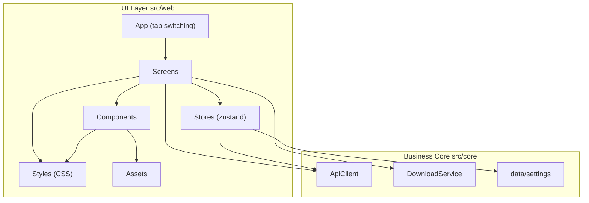
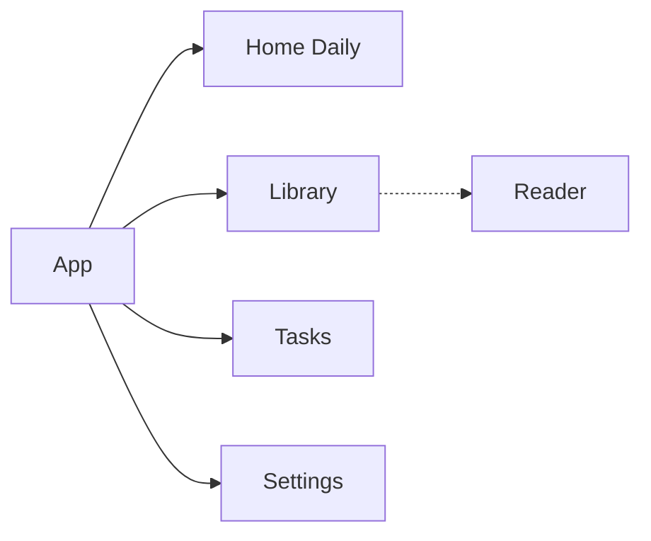
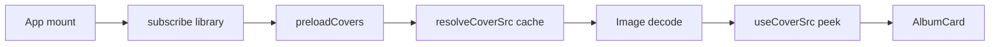
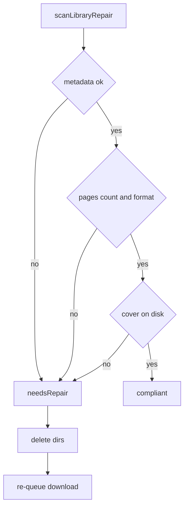

# UI Architecture

The JMFM UI layer lives in `src/web` (React DOM + CSS) inside the Capacitor WebView, fully separated from the business core `src/core`. The UI consumes business capabilities through three entry points only: `ApiClient`, `DownloadService` and `Settings`. It never touches networking, crypto or file logic directly.

## Layering



- **App**: lightweight state-based tab switching hosting the 4 main screens (no routing library).
- **Screens**: page-level components responsible only for composition and event dispatch, with no business implementation.
- **Stores**: zustand stores for UI state, bridging the core services.
- **Components**: presentational components without business semantics.
- **Styles**: all styles are separate CSS files under `src/web/styles/`; tsx files contain no inline style sheets.
- **Assets**: icons (Iconify SVG) and fonts (Alimama / BebasNeue) are stored centrally.

## Navigation



### Page table

| Name | Component | Description |
| --- | --- | --- |
| `Home` | `HomeScreen` | daily recommendation feed |
| `Library` | `LibraryScreen` | local library + search + category filters (all / favorite / downloaded / recent) |
| `Tasks` | `TasksScreen` | download queue and progress (serialized) |
| `Settings` | `SettingsScreen` | app settings |
| `Reader` | `ReaderScreen` | reader: direct image reading (new downloads) or pdf.js fallback (legacy PDFs) |

## Screen responsibilities

- **Home**: sections top to bottom are topbar (brand + search) → hero (weekly spotlight) → continue reading → daily grid → popularity Top 8 → recent updates (relative time) → category chips. Everything derives from existing stores, no new endpoints: the hero is the highest `likesCount` pick, the ranking reuses `useBrowseStore.hot`, and updates are `useDailyStore.albums` sorted by `updateAt`. Picks still come from `buildRecommendations` (whitelist → favorite tags → time-tiered fill) and stay cached per day with dismiss / refresh.
- **Library**: lists downloaded albums with search and four category filters (all / favorite / downloaded / recent); supports favorite, delete and open. Delete uses `ConfirmDialog`.
- **Tasks**: download queue with live progress, pause / resume / delete; albums serialized via `queue.ts`; done tasks leave after 3s with a GSAP height collapse; card is left-aligned title + status badge (no check icon).
- **Reader**: when `ReaderTarget.pagesDir` exists, uses direct image reading (`image-reader.tsx` + `image-loader.ts`): scroll window ±1/+3, horizontal three-slide track; otherwise pdf.js fallback. `ReaderScreen` is lazy-loaded via `React.lazy`; pdf.js is imported dynamically only in PDF mode.
- **Settings**: theme, reading mode, download path (with SAF directory grant), proxy toggle; **General → Repair files** scans and backfills missing pages and covers with an always-visible progress bar and queue hint (survives tab switches); **Check for updates** download progress lives in `useUpdateStore`, so it stays visible after leaving and returning.

## Cover preload



- `src/web/library/coverCache.ts`: URI cache + inflight dedupe + `preloadCovers`.
- Warmed for the first 8 covers on app start / library change (the rest are lazy), and immediately after insert, so tab switches do not jump from cover loads.

## Library repair



## State management

| Store | Responsibility |
| --- | --- |
| `useSettingsStore` | wraps `data/settings` load and persistence (Capacitor Preferences / localStorage) |
| `useDownloadStore` | download task set and progress (pending / running / paused / done / error) |
| `useLibraryStore` | locally downloaded albums (`LibraryItem`, with `pagesDir` / `coverPath`), favorite / recent / delete |
| `useDailyStore` | today's recommendation pool, dismiss, refresh; fetching lives in `library/dailyFetch.ts` |
| `useBrowseStore` | category tree plus weekly hot (`hot` / `loadHot`), shared by Home and Discover |
| `useBrowseFeedStore` | Discover paginated cache keyed by `category\|order`, merged via `library/pagedFeed.ts` |
| `useSearchStore` | search result pagination, reusing the same `pagedFeed` slice shape |

### Paging and skeletons

- Page merging (append / dedupe / end / LRU cache) is centralized in `src/web/library/pagedFeed.ts`; `browseFeed` and `search` keep only their API differences.
- **Stale-while-revalidate**: switching category/order with no cache for the new key keeps rendering the previous list and shows a thin progress bar (`.nav-scroll.is-switching`) instead of flashing `EmptyState`.
- **Infinite-scroll gating**: `useInfiniteScroll` fires once per visibility and re-arms only after the request settles (`disabled` back to false), so it cannot pile up pages while loading.
- **Skeletons**: `src/web/components/Skeletons.tsx` + `styles/skeleton.css` provide six-card grid, list row, hot rail, and category tile placeholders. They replace `app-empty` while loading, and `app-empty--fixed` reserves 240px so the page never collapses.

## Interaction constraints

- `ListTile` renders a `<div role="group">` root when `isInput`, `isToggle`, or `trailing` is a ReactNode; only fully clickable rows use `<button>`. This prevents `<button>` inside `<button>`.
- Store selectors that return arrays or objects need `useShallow` (or a boolean projection); otherwise React 19 treats `getSnapshot` as unstable and loops forever.
- **Tab keep-alive**: `useTabKeepAlive` mounts a tab on first visit and keeps it; inactive panes are `hidden` and restore their `.app-screen` `scrollTop` on return. Library still mounts lazily to avoid an eager disk scan.
- **Edge swipe back**: `useEdgeSwipeBack` arms only while an overlay exists; a touch starting within 28px of the left edge that travels past 64px horizontally pops the stack. Drag writes `.nav-layer` transform directly and releases into `is-closing`.
- **Hide-on-scroll**: `useHideOnScroll` listens in the capture phase for `.app-screen` scrolls and hides the tabbar plus home topbar after 24px downward (`.chrome-hidden`), restoring on upward scroll or when back at the top.
- **Pull-to-refresh**: `usePullToRefresh` runs only for coarse pointers, requires the scroller at the top and an 80px pull; Home refreshes picks plus the hot rail while `is-pulling` / `is-refreshing` drive the indicator.

## Style system

`src/web/theme/index.css` has two layers: **primitives** (`--c-ink-*`, `--c-coral-*`, `--c-jade/amber/rose`, `--c-tint-*`) and **semantic** roles (`--surface-*`, `--ink-*`, `--accent-*`, `--cover-*`, `--color-edge`, `--hairline`, `--scrim(-weak)`, `--radius-*`, `--shadow-1/2/3`, `--dur-*`, `--ease-*`).

- **Dark first**: `:root` is the dark semantic set; `[data-theme='light']` only rebinds primitives/aliases, component selectors never change. `src/data/settings.ts` defaults to `theme: 'dark'`.
- Component CSS references semantic tokens only; no raw hex or `rgba()`. Covers use `--cover-tint-1..6` with `--cover-scrim` / `--cover-scrim-full` gradients.
- Page and component styles live in dedicated files under `src/web/styles/`; no inline stylesheets in tsx.
- `--ease-emphasized` plus the `--dur-*` steps drive nav, tab and card motion; `prefers-reduced-motion` collapses durations to 1ms.

### Card system

`Poster` (`components/Poster.tsx` + `styles/poster.css`) is the single cover base: `useCoverSrc` lookup, fade-in, title-fragment fallback, `--cover-tint-*` backdrop, optional scrim and badge layer.

| Variant | Component | Shape |
| --- | --- | --- |
| `AlbumCard` | grid card | 3:4 cover, scrim tags, corner actions, two-line title |
| `AlbumRow` | list row | 3:4 thumb, title/author/`meta`/stats, optional download or chevron |
| `HomeHero` | home spotlight | full-bleed crop, bottom gradient, title and meta |
| `RankItem` | popularity list | rank number, 1:1 thumb, title/author, likes |
| `ContinueCard` | resume rail | thumb, title, progress bar |

### Icons

- Source: [Iconify Material Symbols](https://icon-sets.iconify.design/material-symbols/), stored as SVG files in `src/web/assets/icons/`.
- **Uniqueness**: one file per semantic, no copy-and-rename, no duplicate `path d`; grep for references before deleting.
- `scripts/gen-icons.ts` generates `src/web/generated/icons.ts` (an SVG string map); `scripts/check-icons.ts` enforces naming, duplicate paths, generated drift, unknown and unused references.
- The `Icon` component renders them inline with `dangerouslySetInnerHTML`; icons use `currentColor`, so the color comes from surrounding CSS.
- Tab icons: `home`, `auto-stories`, `download`, `settings`.

### Fonts

| File | fontFamily | Usage |
| --- | --- | --- |
| `AlimamaShuHeiTi-Bold.woff2` | `Alimama ShuHeiTi` | Chinese titles, branding |
| `Nagino.woff2` | `Nagino` | Japanese titles |
| `BebasNeue.woff2` | `Bebas Neue` | Latin and numerals, display type |

- Source fonts live in `src/web/assets/fonts/` (all woff2, converted/slimmed from otf/ttf).
- `src/web/styles/fonts.css` registers them via `@font-face`; Bun build bundles them automatically.

## Directory layout

```
src/web/
  assets/
    fonts/                # Alimama / BebasNeue / Nagino (woff2)
    icons/                # Iconify SVG
  components/             # Icon / AlbumCard / ConfirmDialog / SearchBar / ...
  download/               # createDownloadRuntime / safRuntime / taskCleanup
  generated/              # icons.ts (generated)
  hooks/                  # useDownloadTask / useCoverSrc / useKeyboardVisibility / ...
  library/                # saveToLibrary / coverCache / repairLibrary / discoverLibrary / daily / tags / uid
  reader/                 # image-doc / image-loader / image-reader / pdf-doc / paged-viewer / scroll-viewer
  screens/                # Home / Library / Tasks / Settings / Reader
  stores/                 # zustand stores
  styles/                 # CSS style modules
  theme/                  # Cirrus tokens (CSS variables)
  util/                   # cacheRegistry (cache invalidation registry)
  App.tsx                 # tab switching + cover warm + lazy Reader mount
  main.tsx                # ReactDOM.createRoot entry
  index.html              # WebView host page
```

## Build & run

```bash
bun run build            # bun build → dist/
bunx cap sync android    # sync web assets into the native project
bunx cap run android     # build and run on a connected device
bash scripts/dev-android.sh   # one shot: build → sync → run (device first)
bun run apk              # one shot debug APK → dist-apk/
```
